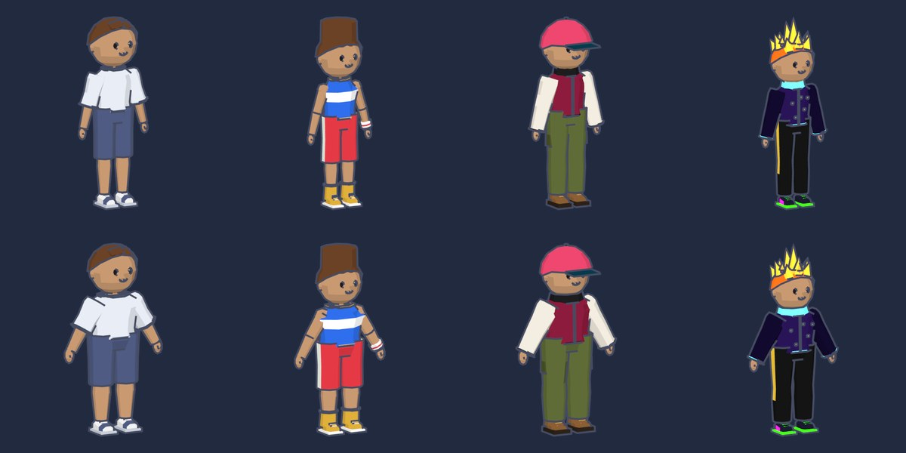
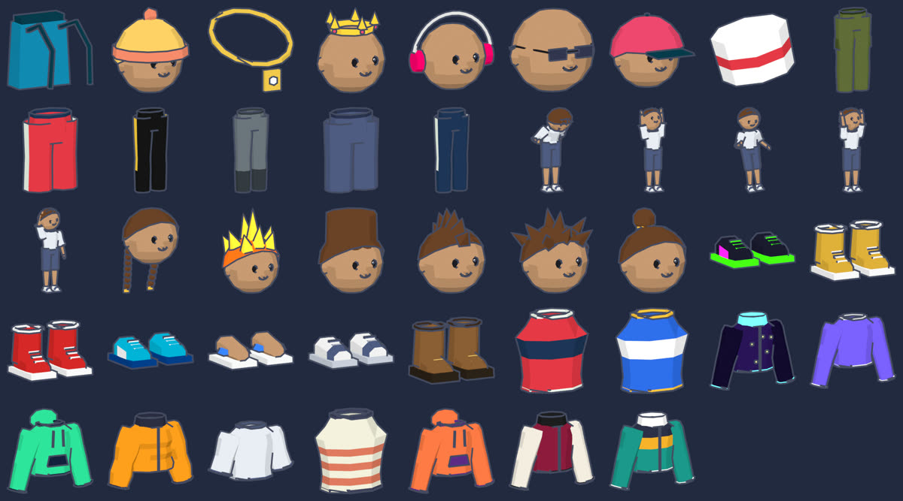

# Avatar and catalog art

The beta art is code-built in this repository (decision 3, amended 2026-11-10). Python scripts make every
mesh, Blender 4.5 LTS exports glTF 2.0 and renders the thumbnails, and a checker verifies the budgets of
spec §9 in CI. No generative-model (AI) tool makes or changes any asset. A contractor can later replace
items on the same rig and manifests.





## Files

| Path | Content |
|---|---|
| `assets/source/vybe_art/geom.py` | Low-poly primitives in plain Python (rings, tubes, boxes, shells) |
| `assets/source/vybe_art/rig.py` | The rig: bone names, bind pose, body regions, body preset sizes, `RIG_VERSION` |
| `assets/source/vybe_art/body.py` | Base avatar: body regions, 4 faces, 4 preset hair styles |
| `assets/source/vybe_art/wardrobe.py` | Garment and accessory builders |
| `assets/source/vybe_art/catalog.py` | Assets (one `.glb` each) and items (one sku each), `CATALOG_VERSION` |
| `assets/source/vybe_art/emotes.py` | Emote keyframes and the idle loop |
| `assets/source/vybe_art/palette.py` | Skin tones, hair colors, material helper |
| `assets/source/vybe_art/blender.py` | The only module that uses Blender (`bpy`): objects, export, thumbnails |
| `assets/source/build.py`, `build.sh`, `Dockerfile` | Pipeline entry point and the pinned Blender image |
| `assets/tools/publish.py` | Content-addressed file names and the manifests |
| `assets/tools/check_assets.py` | Budget and compatibility check (CI) |
| `assets/published/3d/` | Generated files, served at `/assets/3d/` (do not edit) |
| `assets/manifests/catalog.v1.json`, `avatar-3d.v1.json` | Generated manifests (do not edit) |
| `assets/LICENSES.md` | License record for every asset |

## Build

Prerequisite: Docker (Docker Desktop on an Apple-silicon Mac).

1. Run the pipeline from the repository root:

   ```bash
   assets/source/build.sh
   ```

2. Run the check:

   ```bash
   python3 assets/tools/check_assets.py
   ```

3. Commit `assets/published/`, `assets/manifests/` and the source change together.

The first run builds the image `vybe-art:<hash>` (about 2 GB, 3–5 minutes). A full build takes about
1 minute. To render outfit previews (not published) to `assets/build/previews/`, add `--previews`.

The image is `linux/amd64` on purpose. CI (ubuntu-24.04) and a Mac (Docker Desktop with Rosetta) run the
same image, so they make the same bytes. CI rebuilds the art and fails when the result differs from the
committed files. The pipeline is deterministic: coordinates are rounded to 0.01 mm, the renders use one
thread and a fixed seed, and `publish.py` removes the date from the PNG files. Models and manifests are the
same bytes on both machines. Thumbnails can differ in a few edge pixels, because Cycles uses other CPU code
paths under Rosetta; `assets/tools/compare_build.py` accepts at most 2 % changed pixels per thumbnail.

The scripts also run in the Blender 4.5 app: `blender -b --factory-startup -P assets/source/build.py`.
The Docker image stays the reference for the committed bytes.

## Style

- Stylized low-poly toon. Flat faces, no smooth normals, no textures. The web viewport and the thumbnails
  use three flat light bands and a dark outline.
- Cartoon proportions: a large head (about one quarter of the height), short arms, a clear silhouette at
  small mobile sizes.
- No realistic skin. Skin is one flat color from the preset (`skin_01`–`skin_06`).
- No gendered clothing. Every item fits both bodies, except where `compatibleBodyPresets` says otherwise.
  Body B has broader shoulders and thicker limbs; it is not a gender.
- Saturated colors with a clear light-dark contrast inside each item. Do not use color alone to tell items
  apart: change the shape too (stripes, trims, pockets, collars).
- Epic items have emissive (glowing) parts. Common items do not.

## Conventions

| Topic | Rule |
|---|---|
| Format | glTF 2.0 binary `.glb`, no textures, no normals (flat shading), no compression extensions |
| Axes and units | Meters. Y up in glTF (Z up in Blender). The avatar faces +Z in glTF (-Y in Blender). Origin at the ground center |
| Rig | One armature, `RIG_VERSION = vybe-rig-1`, 20 bones (`rig.py`). Every item file holds the full rig with the same bind pose |
| Body presets | One mesh per item; `body_b` is a shape key (glTF morph target `body_b`) |
| Body regions | `head`, `neck`, `torso`, `hips`, `upper_arms`, `lower_arms`, `hands`, `upper_legs`, `lower_legs`, `feet`. An item hides the regions in `hideBodyRegions` and must cover them. `hair` hides the hair (hats) |
| Required masks | A top hides `torso`, a bottom hides `hips`, shoes hide `feet` |
| Accessories | Mesh `<asset>_point_1` on `attachBone`. A left bone (`lower_arm_L`) also has the mirrored `<asset>_point_2` for attachment point 2 |
| Materials | Named by role: `primary`, `secondary`, `accent`, `trim`, `sole`, `metal`, `gem`. `skin` and `hair` take the player's preset colors at run time |
| Color variants | One asset, several skus: `textureVariants` lists `{material, color}` overrides per sku |
| Emotes | A file with the rig and one animation `emote_<name>`, at most 6 s |
| File names | `/assets/3d/<folder>/<name>.<first 12 hex of sha256>.<ext>`: immutable, cached for one year |
| Item pictures in the API | `previewUrl` (catalog, inventory) is the item's `thumbnailUrl` on the web origin (`Challenges:ShareBaseUrl`), or on `Content:AssetOrigin` when it is set |

## Budgets (spec §9)

The checker computes the worst case (the largest item in every slot and the two largest accessories) and
fails CI when a budget is exceeded.

| Budget | Limit | Now |
|---|---|---|
| Visible avatar triangles | 25,000 | about 3,500 |
| Draw calls for the avatar | 60 | 29 |
| Initial avatar download (base + starter items) | 2 MB | about 165 KB |
| Heaviest outfit download | 2 MB | about 230 KB |
| Texture size | 1024 px | no textures |

## Add an item

1. Pick or make an asset in `assets/source/vybe_art/catalog.py` (`ASSETS`).
   - For a color variant, reuse an asset and add `colors={...}` to the item.
   - For a new shape, add a builder in `wardrobe.py`. Take `Dims` as the first argument and use
     `d.torso_at(z)`, `d.limb` and the joints of `rig.py`, so the body B shape key works.
2. Add the item to `ITEMS`: sku (`<slot>_<name>`), display name, price inside the band of its rarity
   (common 300–800, rare 1,500–3,000, epic 6,000–10,000), rarity, minimum level, asset id, `assetKey`.
3. Increase `CATALOG_VERSION` when the release adds or changes items.
4. Build, check and look at the thumbnail in `assets/build/thumbs/` and a preview (`--previews`).
5. Commit the source, `assets/published/` and the manifests in the same change.

Never remove or rename a sku that players can own. To change the art of an asset, increase its `version`
(`assetVersion` in the manifest); the file name changes with the content.

## Add an emote

1. Add a keyframe function to `emotes.py` and register it in `EMOTES` and `PEAK` (the thumbnail frame).
2. Add an `Asset(..., emote="<name>")` and an item with the slot `emote`.

## Replace the art later (contractor)

A contractor delivers Blender files on the same rig (`rig.py`: names, bind pose, axes). The pipeline then
loads their meshes instead of the code builders; the manifests, file names, checker and viewer stay the same.
Record each delivery in `assets/LICENSES.md` (work-for-hire, rights assigned).
